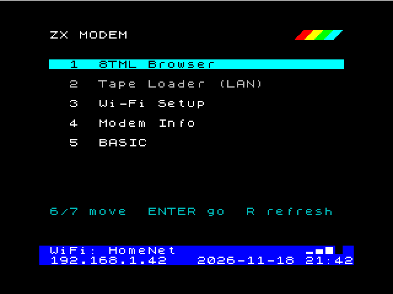
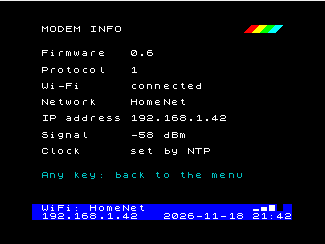
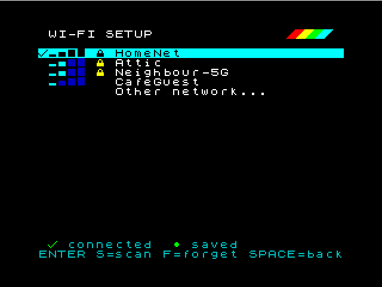
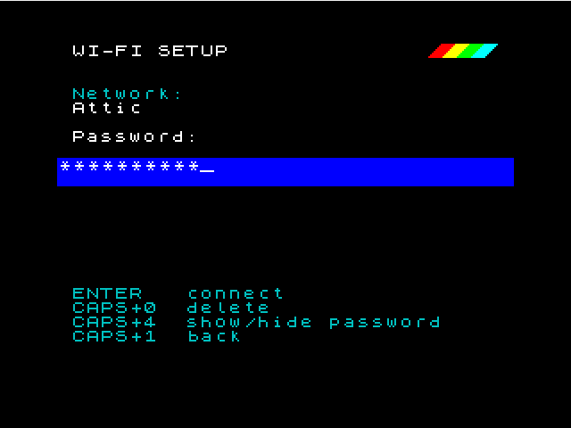
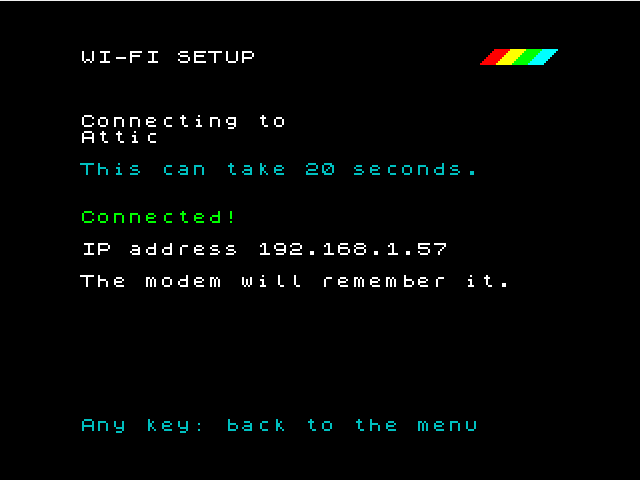
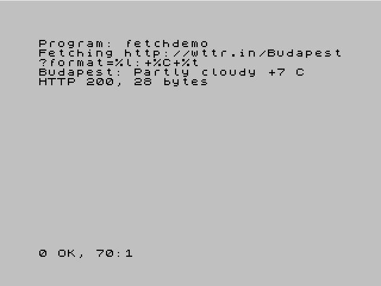

# ZX MODEM

A Wi-Fi network modem for an **unmodified ZX Spectrum 48K**. An ESP32 talks
to the Spectrum through its **EAR and MIC tape sockets**, using the
Spectrum's own ROM tape routines in both directions: no hardware changes, no
expansion port, no custom Spectrum audio code.

On top of it runs a small app platform: a menu with a live status line
(network, signal, IP, date and time), a Wi-Fi setup screen on the Spectrum
itself, web fetches from BASIC, and an 8TML browser in the making
([zx-vvv](apps/zx-vvv/)).

**Status:** the modem (Phase 1) works on a real 48K: two-way tape link, menu,
Wi-Fi setup with saved networks, HTTP and HTTPS fetches for BASIC programs.
The browser is next.

## Screenshots

| | |
|---|---|
|  |  |
| **The menu.** Items come from the modem's app list; the status line keeps the time between requests. | **Modem Info:** firmware, protocol, Wi-Fi, address, signal and clock, straight from the modem. |
|  |  |
| **Wi-Fi Setup**, an app the menu downloads: signal bars, padlocks, a tick for the connected network, dots for saved ones. | **Password entry** on the Spectrum's keyboard, masked (CAPS+4 shows it). |
|  |  |
| **Connected:** the modem saves the network and rejoins it by itself. | **From BASIC:** `LET U$="http://wttr.in/..."`, `USR 32771` fetches, `USR 32774` prints. |

*Captured in the Fuse emulator with recorded modem replies standing in for
the ESP32 (so the network names and the time are made up); a real 48K shows
exactly the same screens.*

## Documentation

| Document | For |
|---|---|
| [**ZX Modem Link Protocol 1**](docs/link-protocol.md) | the modem standard: tape signal, packet framing, the registry of services, response types and apps, every command, compatibility rules |
| [**App API**](docs/app-api.md) | writing Spectrum apps and BASIC programs that use the modem: memory map, the fixed call table, a "hello" app, the BASIC `USR` entry points |
| [`sdk/`](sdk/) | the include files apps build against |
| [Hardware](docs/hardware.md) | the carrier board (rev C), connections, pins, revisions |
| [`hardware/DESIGN.md`](hardware/DESIGN.md) | the board's full design notes and simulation |

## How it works

```
   web (HTTP/HTTPS)
        |  Wi-Fi
 +------+--------------------+   EAR (tape signal in)   +-----------------------+
 | ESP32-S3                  | -----------------------> | ZX Spectrum 48K       |
 |  Wi-Fi, TLS, NTP          |                          |  ROM LD-BYTES/SA-BYTES |
 |  tape encoder (RMT)       | <----------------------- |  menu, apps, BASIC    |
 |  tape decoder (edge ISR)  |   MIC (tape signal out)  |                       |
 +---------------------------+                          +-----------------------+
```

The Spectrum saves a short **request** block (`[service][command][args]`); the
modem answers with **header + data** blocks the ROM loader can read. One side
talks at a time. At ROM tape speed that is about 170 bytes/s, so a status
request takes about 6 s and a one-line web reply about 10 s. Details:
[link protocol](docs/link-protocol.md).

## Using it

1. Build the board ([hardware](docs/hardware.md)) or wire an ESP32 dev board
   to the EAR/MIC sockets, and flash the firmware (below).
2. On the Spectrum type `LOAD ""`, then press **PLAY** on the modem. The
   ZX MODEM menu loads (about 20 s) and shows the modem's status.
3. Menu keys: 6/7 or the cursor keys move, ENTER or a digit chooses, R
   refreshes the status.
4. **Wi-Fi Setup** scans and lists networks (a tick: connected, a dot:
   saved). Pick one and type its password (CAPS+0 delete, CAPS+2 caps lock,
   CAPS+4 show/hide, CAPS+1 back). The modem remembers up to 5 networks and
   joins the strongest one in range by itself.

PLAY button, decided when you let go:

| Hold | Action |
|---|---|
| short | send the menu |
| 2-5 s (LED white) | send a tape test program: it prints a message and `SAVE`s 32 ROM bytes, which the modem checks |
| 5 s or more (LED flashing red) | forget all saved Wi-Fi networks |

LED: blue = sending, yellow = receiving, then green (good) or red (bad).
Idle: a short blink every 2 s, green when Wi-Fi is up, amber while
connecting, purple when no network is set.

### From BASIC

Choose **BASIC** in the menu: the menu stays in memory, and any BASIC program
can fetch a web page through it ([App API §5](docs/app-api.md#5-basic-programs)):

```
10 LET U$="http://wttr.in/Budapest?format=%l:+%C+%t"
20 LET N=USR 32771
30 IF PEEK 32777<>0 THEN PRINT "Error ";PEEK 32777;": ";
40 RANDOMIZE USR 32774
```

`https://` works too (the ESP32 does TLS). `RANDOMIZE USR 32768` goes back to
the menu. A longer example: [`zx/basic/fetchdemo.asm`](zx/basic/fetchdemo.asm).

## Next: zx-vvv, an 8TML browser

[8TML](https://t8wn.com/8tml/) is a tiny markup language for a retro web:
plain ASCII pages, readable on 8-bit machines, a lot like Markdown. **zx-vvv**
will be the official ZX Spectrum port of VVV, its reference browser, running
on the 48K through this modem ([`apps/zx-vvv/`](apps/zx-vvv/)):

- **The Spectrum is the browser:** it parses the page itself (headings,
  paragraphs, lists, quotes, preformatted text, emphasis, colour tags,
  links) and lays it out in 32 columns with Spectrum colours, bold and
  italic fonts.
- **Links and history:** cursor keys move between links, ENTER follows one,
  B goes back; G types an address.
- **The modem is the network card:** HTTPS, redirects, resolving relative
  links and checking content types, and converting UTF-8 to ASCII. It never
  pre-renders the page.
- **Later:** stylesheets (`site.8ss`) and forms. The first home page:
  T8wn's own, which is served as live 8TML.

A page and how zx-vvv will lay it out (the layout comes from the 8TML
reference tool, the browser's test oracle):

```
---                                    Hello from a 48K
8tml: 1
title: My plot                         8TML is plain text with a little
case: mixed                            markup: emphasis, colours, links
---                                    and lists.
# Hello from a 48K
                                       * Parsed on the Spectrum itself
8TML is plain text with a little       * 32 columns, Spectrum colours
markup: *emphasis*, <yellow>colours</>,
[links](news.8tml) and lists.

* Parsed on the Spectrum itself
* 32 columns, Spectrum colours
```

## Building

### Firmware (ESP32)

ESP-IDF 5.3 or newer (5.5.1 is what it's tested with). In the `esp32` folder:

```
idf.py set-target esp32s3     # ESP32-S3 SuperMini on the carrier board
idf.py build
idf.py -p COM5 flash monitor  # your serial port
```

`idf.py set-target esp32` builds for a classic ESP32 dev board instead (TX
GPIO25, RX GPIO26, the BOOT button as PLAY). The firmware build assembles the
Spectrum menu and apps itself, so it needs
[sjasmplus](https://github.com/z00m128/sjasmplus) on the path. A Wi-Fi
network can also be preset in `idf.py menuconfig` (ZX modem); it is only
used until one is saved from the Spectrum.

### Host tests and Spectrum programs

CMake, a C compiler and Ninja; sjasmplus for the Spectrum programs. From
the repository root (not `esp32/`):

```
cmake -S . -B build -G Ninja
cmake --build build
ctest --test-dir build
```

This runs the tape encoder/decoder tests (including a real 48K `SAVE`
recording), the UTF-8 converter tests, and writes `build/zxmenu.tap`,
`build/wifisetup.bin` and `build/fetchdemo.tap`.

### Trying Spectrum programs in an emulator

An emulator such as [Fuse](https://fuse-emulator.sourceforge.net/) can't
answer the modem's requests, so append a canned reply for each request the
program makes, in order:

```
python host/tools/fake_reply.py build/zxmenu.tap build/session.tap info:HomeNet overlay:build/wifisetup.bin "netlist:HomeNet/-52/3/3,Cafe/-80/0" info:HomeNet
```

Load `session.tap` in the emulator: the menu, then Wi-Fi Setup, run on the
canned answers.

## Repository layout

| Path | What |
|---|---|
| `docs/` | the protocol standard, the app API, hardware notes |
| `sdk/` | include files for apps |
| `esp32/` | the ESP-IDF firmware (link, Wi-Fi/NTP, fetch, app registry, tape I/O) |
| `components/` | portable C shared by firmware and host: `tape` (encoder/decoder), `translit` (UTF-8 to ASCII) |
| `zx/` | Spectrum code inside the menu (`lib/`, `menu/`), BASIC examples (`basic/`), the first test program (`modemtest/`) |
| `apps/` | Spectrum apps: `wifisetup/` (app 1), `zx-vvv/` (the browser, its own project) |
| `host/` | host tests and `tools/fake_reply.py` |
| `hardware/` | the carrier PCB: KiCad project, generator scripts, BOM/CPL, design notes |

`CLAUDE.md` is the project brief used with Claude Code; it doubles as the
detailed design document.

## Credits

- 8TML and the reference client VVV are by the T8wn project
  ([t8wn.com](https://t8wn.com/8tml/)); zx-vvv is their official ZX Spectrum
  port.
- The planned AT command service follows
  [Zimodem](https://github.com/bozimmerman/Zimodem) by Bo Zimmerman.
- ROM routine addresses were checked against
  [the 48K ROM disassembly](https://skoolkid.github.io/rom/).

## License

[MIT](LICENSE), for the code, documentation and hardware files in this
repository. The 8TML specification package is not included (see
[`apps/zx-vvv/spec/`](apps/zx-vvv/spec/GET-THE-SPEC.md)).
